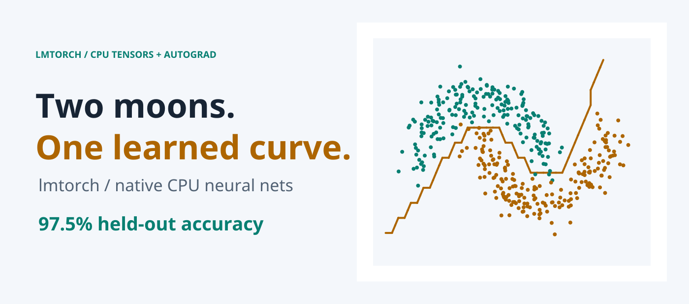
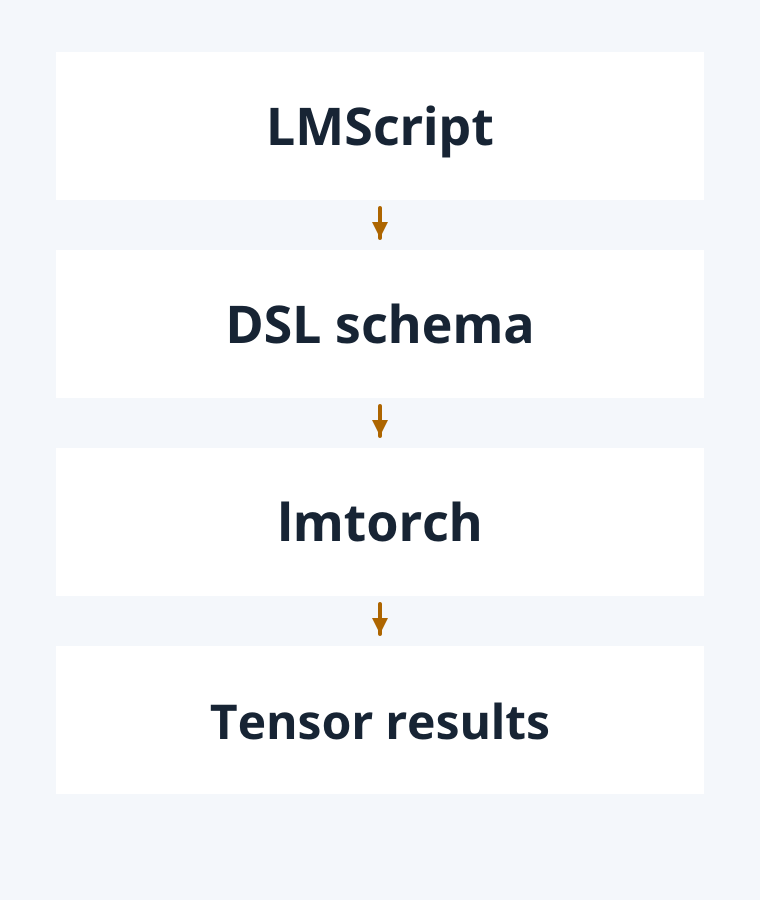
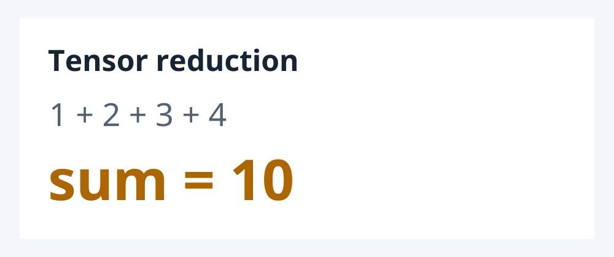
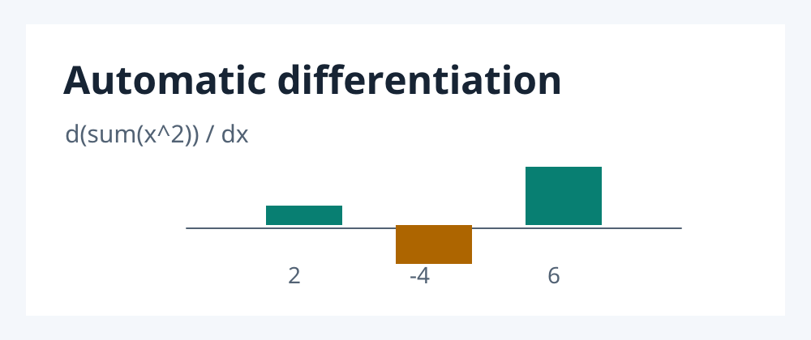
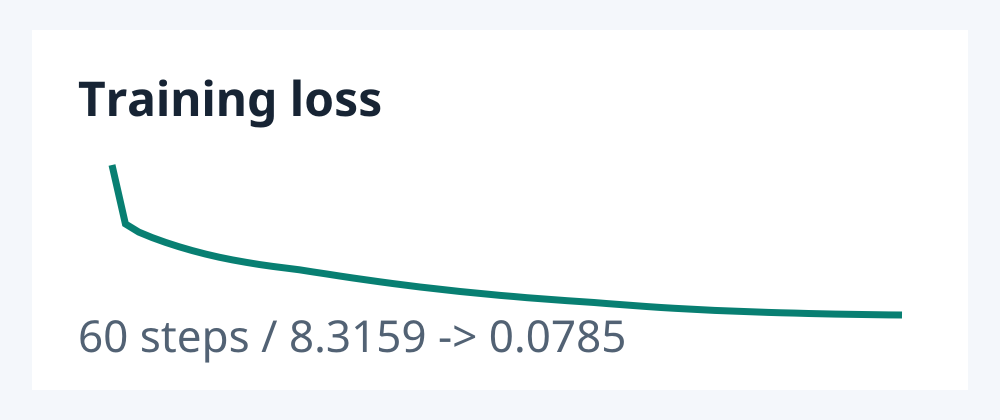
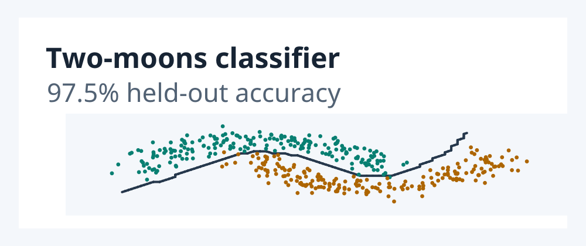

<picture>
  <source media="(max-width: 480px) and (prefers-color-scheme: dark)" srcset="docs/readme/hero-mobile-dark.png">
  <source media="(max-width: 480px) and (prefers-color-scheme: light)" srcset="docs/readme/hero-mobile-light.png">
  <source media="(prefers-color-scheme: dark)" srcset="docs/readme/hero-desktop-dark.png">
  <source media="(prefers-color-scheme: light)" srcset="docs/readme/hero-desktop-light.png">
  
</picture>

# lmtorch

Run CPU tensors, automatic differentiation, and small neural networks from LMScript with one native C++ host.

[](https://github.com/lmctl-ai/lmtorch/releases/latest)
[](https://github.com/lmctl-ai/lmtorch/actions/workflows/ci.yml)

## How it works

<picture>
  <source media="(prefers-color-scheme: dark)" srcset="docs/readme/architecture-dark.png">
  <source media="(prefers-color-scheme: light)" srcset="docs/readme/architecture-light.png">
  
</picture>

The same executable supports safetensors operations and compiled `_lmcode_` programs. Models, gradients, and tensor data stay in the native host; no Python runtime is needed.

## Examples

### Tensor sum

<picture>
  <source media="(prefers-color-scheme: dark)" srcset="docs/readme/gallery-sum-dark.png">
  <source media="(prefers-color-scheme: light)" srcset="docs/readme/gallery-sum-light.png">
  
</picture>

[Source](examples/tensor-sum-dsl.lms) | [Book page](https://lmctl.com/tools/lmtorch/examples/tensor-sum.html)

### Automatic differentiation

<picture>
  <source media="(prefers-color-scheme: dark)" srcset="docs/readme/gallery-gradient-dark.png">
  <source media="(prefers-color-scheme: light)" srcset="docs/readme/gallery-gradient-light.png">
  
</picture>

[Source](examples/autograd-gradient-dsl.lms) | [Book page](https://lmctl.com/tools/lmtorch/examples/autograd-gradient.html)

### Training loss

<picture>
  <source media="(prefers-color-scheme: dark)" srcset="docs/readme/gallery-training-dark.png">
  <source media="(prefers-color-scheme: light)" srcset="docs/readme/gallery-training-light.png">
  
</picture>

[Source](examples/train-report-dsl.lms) | [Examples book](https://lmctl.com/tools/lmtorch/examples/)

### Two-moons classifier

<picture>
  <source media="(prefers-color-scheme: dark)" srcset="docs/readme/gallery-classifier-dark.png">
  <source media="(prefers-color-scheme: light)" srcset="docs/readme/gallery-classifier-light.png">
  
</picture>

[Source](examples/classify-moons-dsl.lms) | [Examples book](https://lmctl.com/tools/lmtorch/examples/)

## Quick start

```sh
npm install -g @lmctl-ai/lmctl
lmctl init
lmctl autorun https://lmctl.com/tools/lmtorch/lmtorch_solo.lms
```

## Learn more

- [lmtorch tool book](https://lmctl.com/tools/lmtorch/)
- [Get started](https://lmctl.com/tools/lmtorch/get_started.html)
- [DSL API](docs/dsl-api.md) | [Example guide](examples/README.md)
- [Releases and downloads](https://github.com/lmctl-ai/lmtorch/releases)

## Build and test

Build the native host with `scripts/build-native.sh`; run the examples and checks with `./test.sh`. Release builds and tests cover Linux, macOS, and Windows in [GitHub Actions](https://github.com/lmctl-ai/lmtorch/actions/workflows/ci.yml).

## Third-party notices

See [THIRD_PARTY_NOTICES.md](THIRD_PARTY_NOTICES.md) for bundled components and their licenses.

## License

[MIT](LICENSE). Maintained by Lattice Systems LLC.
