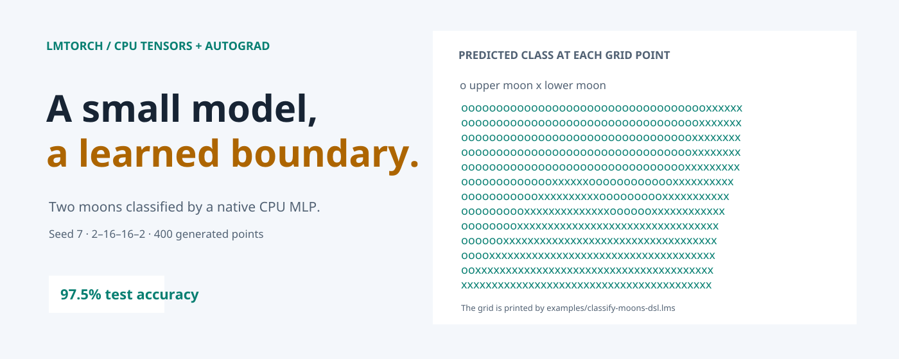
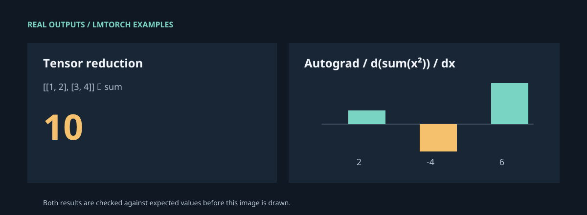

<picture>
  <source media="(prefers-color-scheme: dark)" srcset="docs/readme/hero-dark.png">
  <source media="(prefers-color-scheme: light)" srcset="docs/readme/hero-light.png">
  
</picture>

# lmtorch

Run CPU tensors, automatic differentiation, and small neural networks from LMScript with a single native C++ host.

[](https://github.com/lmctl-ai/lmtorch/releases/latest)
[](https://github.com/lmctl-ai/lmtorch/actions/workflows/ci.yml)

## How it works

<picture>
  <source media="(prefers-color-scheme: dark)" srcset="docs/readme/architecture-dark.png">
  <source media="(prefers-color-scheme: light)" srcset="docs/readme/architecture-light.png">
  
</picture>

The same executable supports stateless safetensors operations and compiled `_dsl_` programs. Models, gradients, and tensor data stay in the native host; no Python runtime is needed.

## Examples



This gallery runs and checks both examples before drawing their values. [Tensor sum source](examples/tensor-sum-dsl.lms) · [Tensor sum book page](https://lmctl.com/tools/lmtorch/examples/tensor-sum.html) · [Gradient source](examples/autograd-gradient-dsl.lms) · [Gradient book page](https://lmctl.com/tools/lmtorch/examples/autograd-gradient.html)

The hero shows the [two-moons classifier](examples/classify-moons-dsl.lms), including its actual predicted decision grid.

## Quick start

```sh
npm install -g @lmctl-ai/lmctl
lmctl init
lmctl autorun https://lmctl.com/tools/lmtorch/lmtorch_solo.lms
```

## Learn more

- [lmtorch tool book](https://lmctl.com/tools/lmtorch/)
- [Get started](https://lmctl.com/tools/lmtorch/get_started.html)
- [DSL API](docs/dsl-api.md) · [Example guide](examples/README.md)
- [Releases and downloads](https://github.com/lmctl-ai/lmtorch/releases)

## License

MIT. Maintained by Lattice Systems LLC.
